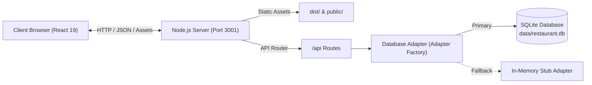

# Ember & Olive — Mediterranean Restaurant & Reservation Platform

[]()
[]()
[]()
[]()
[]()
[]()

> **Ember & Olive** is a production-grade digital platform for a wood-fired Mediterranean restaurant focusing on seasonal dining, interactive menu discovery, and automated table reservations.

---

## Table of Contents
1. [Overview & Highlights](#overview--highlights)
2. [Technology Stack](#technology-stack)
3. [Architecture Overview](#architecture-overview)
4. [Quick Start & Local Setup](#quick-start--local-setup)
5. [Available Scripts](#available-scripts)
6. [Database Management & Migrations](#database-management--migrations)
7. [REST API Reference](#rest-api-reference)
8. [Automated Testing & Quality Gates](#automated-testing--quality-gates)
9. [Production Deployment](#production-deployment)
10. [Documentation Index](#documentation-index)

---

## 1. Overview & Highlights

Ember & Olive delivers a refined dining web experience with:
- **Responsive Mediterranean UI**: Tailored with artisanal styling tokens (deep olive `#3D4D36`, terracotta ember `#C85A32`, linen `#FAF8F5`, warm stone `#66645E`).
- **Menu with Dietary Filtering**: Categorized culinary offerings (Meze & Starters, Coastal Mains, Sweets, Cellar Drinks) with real-time multi-tag filters (`V` Vegetarian, `VG` Vegan, `GF` Gluten-Free, `DF` Dairy-Free, `N` Contains Nuts).
- **Interactive 2-Step Reservations**: Table reservation booking with live lunch and dinner service time slots, party size constraints (1–12 guests), strict RFC email/phone validation, and input preservation.
- **Persistent SQLite Storage**: File-backed relational database storage (`data/restaurant.db`) via Node.js native `DatabaseSync` with zero external database service dependencies and an integrated in-memory fallback adapter.
- **Unified Production Serving**: The Node.js server serves both the REST API routes and compiled static frontend assets (`dist/`) with SPA fallback routing.
- **Strict Accessibility (WCAG 2.1 AA)**: High-contrast focus outlines, contrast ratios exceeding 4.5:1, skip-to-content links, ARIA live regions for form validation, and minimum 44×44px touch targets.
- **Production SEO & Structured Data**: Built-in Schema.org `Restaurant` JSON-LD metadata, Open Graph / Twitter cards, `robots.txt`, `sitemap.xml`, and `llms.txt`.

---

## 2. Technology Stack

| Layer | Technologies |
|---|---|
| **Frontend** | React 19, TypeScript 5.7, Vite 6, Custom Design System Tokens, CSS3 |
| **Backend** | Node.js 22+ (HTTP server with `--experimental-strip-types`), Streaming JSON parser, CORS middleware |
| **Database** | SQLite (`node:sqlite` `DatabaseSync`), SQL migration runner, Seed script |
| **Testing** | Node.js Test Runner (`node --test`), automated integration & validation test suites |
| **Standards** | WCAG 2.1 AA, Schema.org JSON-LD, RESTful API contract specifications |

---

## 3. Architecture Overview



For full architecture diagrams and component breakdown, see [`docs/ARCHITECTURE.md`](docs/ARCHITECTURE.md).

---

## 4. Quick Start & Local Setup

### Prerequisites
- **Node.js**: `v22.0.0` or higher
- **npm**: `v10.0.0` or higher

### 1. Clone & Install
```bash
git clone https://github.com/Jonathan-Acheampong042/Restaurant-Website.git
cd Restaurant-Website
npm install
```

### 2. Initialize Database & Seed Data
```bash
node --experimental-strip-types src/db/cli.ts init
```

### 3. Run Development Servers
- **Start Backend API Server**:
  ```bash
  node --experimental-strip-types src/server/index.ts
  ```
  *(Server runs at `http://localhost:3001`)*

- **Start Frontend Dev Server** (in a second terminal):
  ```bash
  npm run dev
  ```
  *(Frontend available at `http://localhost:5173`)*

---

## 5. Available Scripts

| Command | Action |
|---|---|
| `npm run dev` | Start Vite development server with HMR. |
| `npm run build` | Build optimized production bundle to `dist/`. |
| `npm run preview` | Serve compiled `dist/` directory locally. |
| `npm run typecheck` | Run TypeScript compiler checks (`tsc --noEmit`). |
| `npm test` | Run frontend automated test suite. |

---

## 6. Database Management & Migrations

The database CLI (`src/db/cli.ts`) manages schema migrations and seed operations:

```bash
# Check current database path and applied migrations
node --experimental-strip-types src/db/cli.ts status

# Apply pending migrations
node --experimental-strip-types src/db/cli.ts migrate

# Seed initial categories and dishes
node --experimental-strip-types src/db/cli.ts seed

# Full clean initialization (reset, migrate, seed)
node --experimental-strip-types src/db/cli.ts init
```

Detailed schema and migration documentation: [`docs/DATABASE.md`](docs/DATABASE.md).

---

## 7. REST API Reference

The backend provides standardized JSON REST endpoints wrapped in an `ApiResponse<T>` envelope:

| Method | Endpoint | Description |
|---|---|---|
| `GET` | `/api/health` | Health check & timestamp. |
| `GET` | `/api/restaurant` | Restaurant profile, contact details, and lunch/dinner service hours. |
| `GET` | `/api/menu` | All menu categories and active dishes (supports `?categoryId=` filter). |
| `POST` | `/api/reservations` | Submit and persist a confirmed reservation booking. |
| `GET` | `/api/reservations/:id` | Retrieve reservation details by ID. |
| `GET` | `/api/reservations` | Query reservations by date (`?date=YYYY-MM-DD`) or status. |

### Example: Create Reservation
```bash
curl -X POST http://localhost:3001/api/reservations \
  -H "Content-Type: application/json" \
  -d '{
    "customerName": "Elena Vance",
    "email": "elena@example.com",
    "phone": "206-555-0182",
    "reservationDate": "2026-10-25",
    "reservationTime": "19:00",
    "partySize": 4,
    "specialRequest": "Window table preferred"
  }'
```

Full API specifications, error formats, and request examples: [`docs/API.md`](docs/API.md).

---

## 8. Automated Testing & Quality Gates

All automated test suites execute natively without third-party test runners:

| Test Suite | Command | Coverage |
|---|---|---|
| **Frontend** | `npm test` | 18 tests (Validation rules, dietary filtering, mock fallback) |
| **Backend** | `node tests/backend/run-tests.ts` | 27 tests (Input validation, DB adapters, HTTP API routes) |
| **Database** | `node --test src/db/tests/*.test.ts` | 5 tests (Migrations, CRUD, restart persistence) |
| **Typecheck** | `npm run typecheck` | TypeScript compiler validation |
| **Production Build** | `npm run build` | Vite asset bundling & zero-sourcemap verification |

**Total Suite**: **50 tests passing across all layers**.

Testing guide and details: [`docs/DEVELOPMENT.md`](docs/DEVELOPMENT.md).

---

## 9. Production Deployment

In production, run the unified server to serve both the API and the compiled frontend:

```bash
# 1. Install dependencies
npm ci

# 2. Build frontend assets
npm run build

# 3. Initialize database
node --experimental-strip-types src/db/cli.ts init

# 4. Start production server
node --experimental-strip-types src/server/index.ts
```

- Mount the `data/` directory to a persistent storage volume for SQLite durability.
- Configure `PORT` (default: 3001) and `HOST` (default: `0.0.0.0`).

Complete deployment and container configuration: [`docs/DEPLOYMENT.md`](docs/DEPLOYMENT.md).

---

## 10. Documentation Index

- [`docs/ARCHITECTURE.md`](docs/ARCHITECTURE.md) — Architectural overview, subsystem designs, and data flows.
- [`docs/API.md`](docs/API.md) — Complete REST API endpoint reference and payload specifications.
- [`docs/DATABASE.md`](docs/DATABASE.md) — Relational schema, tables, migrations, and CLI guide.
- [`docs/DEPLOYMENT.md`](docs/DEPLOYMENT.md) — Production deployment guidelines, environment variables, and Dockerfile.
- [`docs/DEVELOPMENT.md`](docs/DEVELOPMENT.md) — Local developer setup, testing commands, and project structure.
- [`.team/CONTRACTS.md`](.team/CONTRACTS.md) — Authoritative team contracts and shared TypeScript types.
